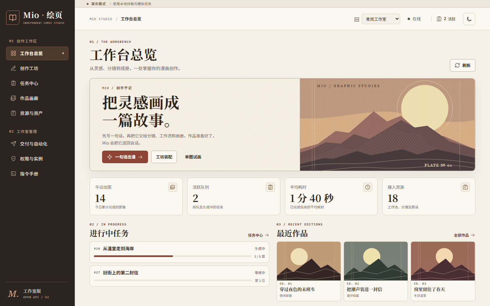
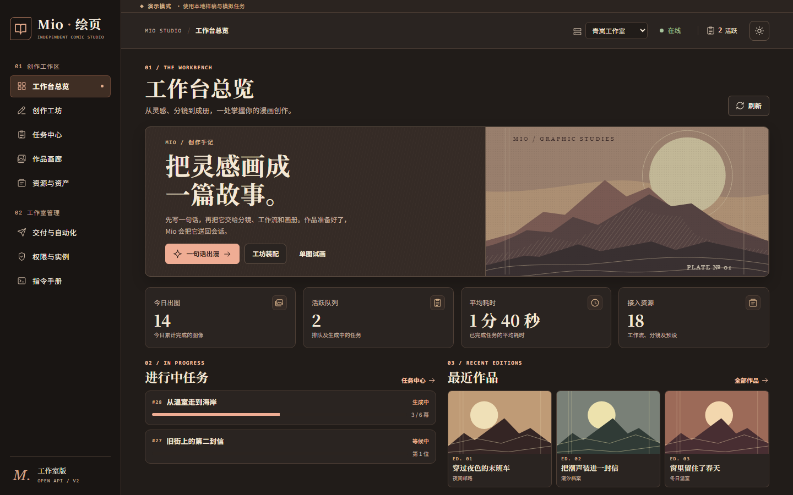
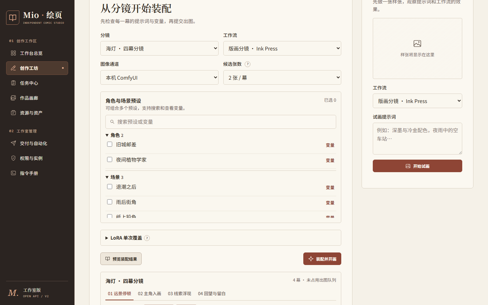
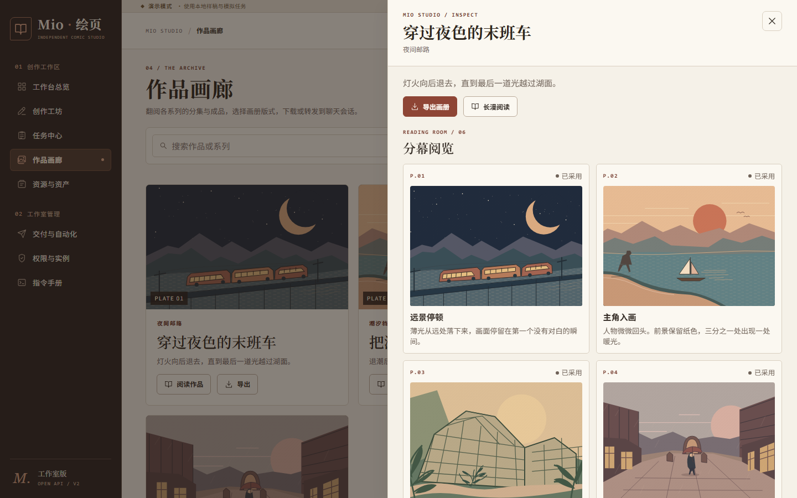

# Mio · 绘页

把 Mio · 绘页的漫画创作能力带进 AstrBot：从一句灵感生成分集剧本、工坊装配、单图试画，到群聊里看进度、选候选图、做质检和发送成品。控制面板用中文工作室界面连接多台 Mio 实例，并管理作品、交付和群聊规则。

本插件使用 Mio 的 **开放 API v2**；本机默认连接 \`http://127.0.0.1:8788\`。它不需要 Mio 补丁、\`mio-patch/\` 目录或 API v1。旧服务会提示升级。

适配 AstrBot 4.27–4.x。插件端必需依赖只有 aiohttp；Pillow 可选，用于生成聊天图片卡片，缺少中文字体或 Pillow 时自动回退为文字。

## 三步开始

1. 在 AstrBot 安装插件，并启动支持开放 API v2 的 Mio · 绘页。
2. 在 Mio 创建具有 \`read\`、\`write\` 和 \`render\` 权限的开放 API 令牌。只有要管理 Webhook 时才需要令牌的 \`admin\` 权限。
3. 打开 **插件页面 → Mio 绘页**，填写 Mio 地址和令牌，点击测试连接；回到聊天使用 \`/mio ping\`。然后运行 \`/mio ls\` 看看有哪些分镜，再试试 \`/mio draw 一个雨夜车站的故事\`。

令牌在面板中只显示已设置状态，并按实例地址保存在 AstrBot 插件数据的 SQLite 中。也可以在原生插件设置里填写环境变量名（默认 MIO_API_V2_TOKEN），再由 AstrBot 进程读取环境变量。令牌不会写入截图、页面清单、任务快照和审计事件。重设或移除令牌请到已登录的 AstrBot 面板或清理对应环境变量。

## 从群聊创作

\`/mio draw <一句话>\` 让 Mio 写一话剧本并生成多幕漫画。可用 \`--style\` 选择预设风格、\`--candidates\` 指定候选张数、\`--series\` 添加到已有系列、\`--tpl\` 选择画册模板。名称包含空格时用引号括起来。生成是异步的，任务接受后用 \`/mio status\` 看进度、\`/mio works\` 浏览作品；任务完成后自动按会话规则发摘要、逐幕图、长漫或画册。

示例：

    /mio ls
    /mio preview 1 2 3
    /mio use 1 2 3
    /mio trial 一把旧伞漂在深夜的运河上
    /mio draw “灯塔底下住着一座会说话的城” --style 2 --candidates 3
    /mio redraw 7 2 换成远景，保持人物和色调
    /mio pick 7 2 1
    /mio qa 7
    /mio works 城市
    /mio export 1 pdf
    /mio get 7
    /mio quota

| 命令 | 用途 |
| --- | --- |
| \`/mio ls [wf\|sb\|ps\|ch\|tpl\|kit]\` | 查看工作流、分镜、预设、通道、画册模板和创作套件；编号按上次返回的目录显示，超长目录在控制面板浏览 |
| \`/mio preview <工作流#> <分镜#> <预设#>\` | 无出图地预览装配结果和缺失变量 |
| \`/mio use [工作流#] <分镜#> [预设#,预设#] [通道#]\` | 将分镜交给 Mio 工坊生成；空缺选项可使用面板默认值 |
| \`/mio draw <灵感> [--series 系列] [--style 预设] [--candidates 数量] [--tpl 模板]\` | 写分集剧本并出漫 |
| \`/mio trial <提示词> [工作流#]\` | 快速试画单图 |
| \`/mio status [#]\`、\`/mio jobs\` | 查询自己发起的任务和排队位置 |
| \`/mio pause #\`、\`/mio resume #\`、\`/mio cancel #\`、\`/mio rm #\` | 暂停、继续、停止或删除自己的任务记录 |
| \`/mio redraw <任务#> <幕#> [提示词]\`、\`/mio pick <任务#> <幕#> <候选#>\` | 重画单幕，或采纳某个候选 |
| \`/mio qa #\` | 让 Mio 检查画面质量，并在完成后汇总分幕结果 |
| \`/mio get [任务#] [html\|pdf\|zip\|strip\|slices\|motion\|img] [模板#]\` | 取回自己的作品 |
| \`/mio works [关键词]\`、\`/mio export <作品#> [格式] [模板#]\` | 浏览画廊，导出历史作品 |
| \`/mio wizard\` | 三步创作向导；回复选择或“取消”，其他聊天不被向导拦截 |
| \`/mio quota\`、\`/mio mode <通知方式>\`、\`/mio ping\`、\`/mio help\` | 查看额度、设置当前群交付规则、检查连接和查阅帮助 |

资源浏览和新建作品支持指定实例，如 \`/mio ls wf --instance backup\`。任务一经创建，后续控制与取件始终指向创建时的实例。用户只能查看和操作本人在同一会话发起的任务；管理员可以管理全局任务。访客可浏览画廊和取件，但不能改动其他人的任务。

## 中文工作室面板

AstrBot 的独立工作室页面在未连接 AstrBot 时可直接离线演示。默认使用内置样稿；浏览器地址增加 ?demo=1 可强制开启演示模式，不连接 Mio，也不需要 CDN。

面板分为八个工作视图：工作台总览；一句话创作和精确装配；任务队列与单幕候选；作品画廊和导出；工作流、分镜、预设、通道与创作套件目录；通知规则和签名 Webhook；权限、配额及多实例；带双语说明的指令构建器。暖纸和深墨主题可手动切换，手机使用底部导航。

默认使用受保护的 Mio 任务轮询；有公开可达的网络回调时，可在面板开启签名 Webhook。可选监听器默认关闭并仅绑定 127.0.0.1，需要跨网络接收时，请明确配置可信反向代理和回调基址。回调由 HMAC-SHA256 验签，消息过期窗口和已接收投递 ID 都会检查；回调只促使插件向 Mio 核实状态，不直接信任传入的任务结果。

## 群聊隔离与资源治理

- admin 管理员可操作全局配置和任务；creator 可创建和管理自己的任务；viewer 只可浏览和取件。
- SQLite 原子记录任务归属、实例快照、本地稳定编号、队列、每日和云端配额、冷却、会话规则、Webhook 去重记录及审计摘要。
- 全局并发和个人并发限制在任务入队事务中检查。队列按先后顺序工作，取消或暂停需要通过该单任务的 API 操作，不会意外暂停整个 Mio 队列。
- 文件下载限制数据大小和缓存容量；聊天图片仅通过插件服务端代理，不要求浏览器直接访问内网 Mio。
- 会话规则可单独设置通知、发送模式、画册模板和图片档位。群主可在所属群内调整发送规则。
- 创作记录不保存会话正文或原始 Mio 错误详情；提示词只随当前 Mio 请求发送，并且仅保存完成任务所需的最少创作输入。

首次启动会以事务迁移旧 tasks.json，保留编号、会话和发起者后将原文件留档。旧任务仅作为历史记录展示；它们没有可推断的 v2 作业 ID，因此旧任务不能远程重跑、停止或导出，旧作品仍可在 Mio 画廊查看。

## 开发、验证与发布

需要 Python 3.11+、Node.js 20.19+ 或 22.12+、npm。安装开发依赖并运行检查：

    python -m pip install -r requirements-dev.txt
    python -m ruff check .
    python -m ruff format --check .
    python -m pytest -q
    cd web-src
    npm ci
    npm run typecheck
    npm run build

web-src/ 包含可复现的 Vite + TypeScript 页面源码；npm run build 生成 AstrBot 页面所需的离线单文件 JavaScript，并更新 pages/mio-studio/。提交时应同时包含两者。GitHub Actions 会运行 Python 测试、Ruff、前端类型检查与构建，并确认构建没有修改已经提交的页面产物。

本地真实服务协议验收可以运行 python scripts/smoke_upstream.py <comfy-comic-studio 仓库根目录>。脚本只启动隔离的 loopback Mio 服务，使用临时数据库、伪造的图像执行器和固定文本替身；不会触碰现有 Mio 数据目录，也不会访问外部付费 API。

## 常见问题

**提示旧版 API 或 8788 连接失败？** 升级 Mio 至开放 API v2，确认其服务地址与启动端口，然后用新创建的 mio_ API 令牌连接。旧版 API 地址只用于给出友好的升级提示，不会被后台使用。

**提示缺少 render、write 或 admin 权限？** 到 Mio 的开放 API 管理页面核对该令牌拥有的权限。只生成和取件的常规流程需要 read、write 和 render；Webhook 管理使用 admin。

**任务提示结果未知？** 网络断开时，提交可能已经被 Mio 接收。先打开 Mio 画廊和任务页核对，插件不会盲目重复提交同一项非幂等创作。

**单图试画或工作流不可用？** 在 Mio 资源和通道设置中检查已保存的模型、出图配置和本地 ComfyUI 实例，再通过面板测试通道。面板模型探测只能检查 Mio 已保存的通道，不接收临时私钥或任意地址。

MIT License.
